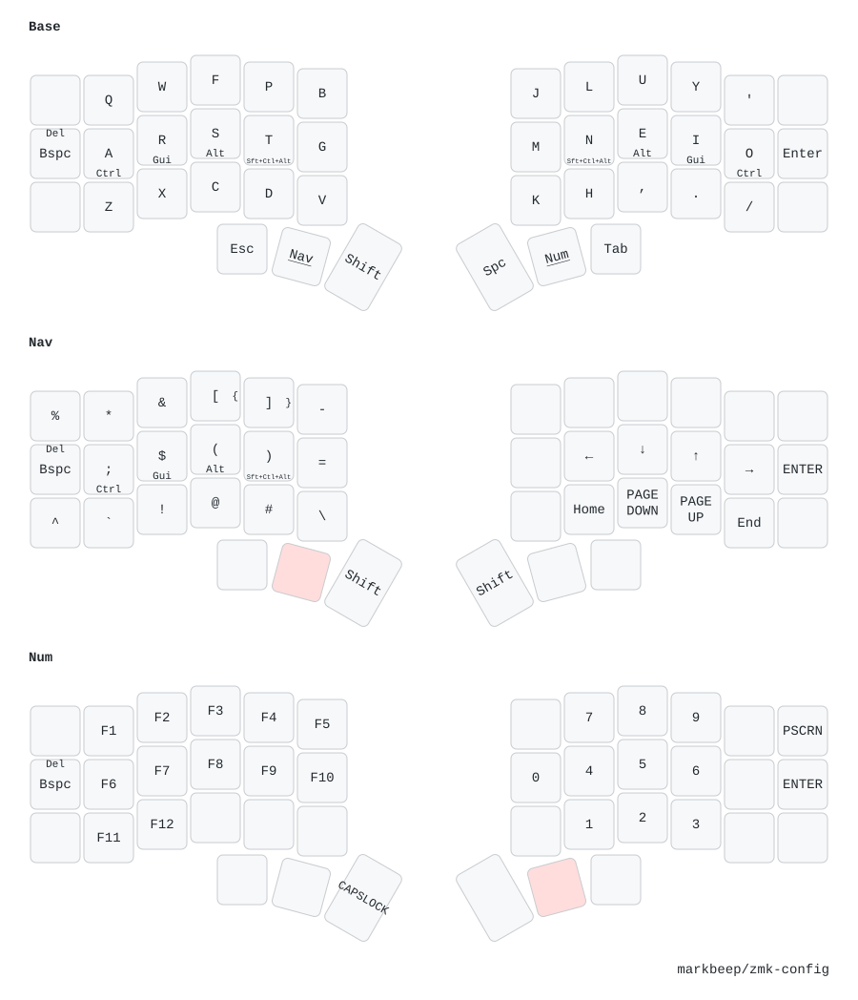
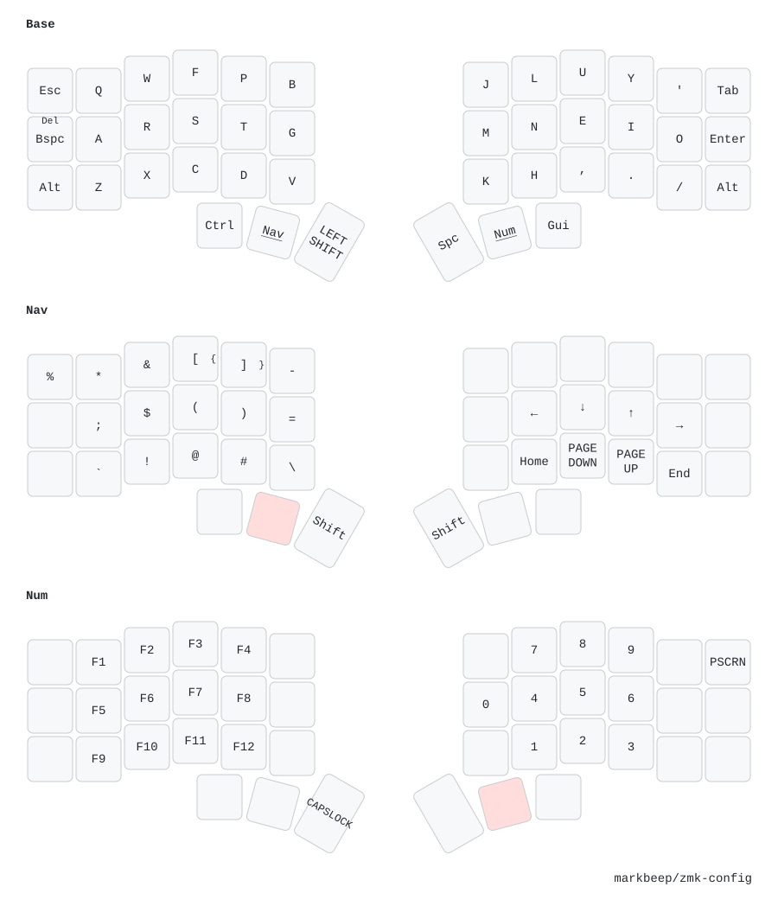

Keymap, loosely based on [urob](https://github.com/urob/zmk-config) and [reddit](https://old.reddit.com/r/crkbd/comments/12y5hip/coding_layout/jhlya5m/).

### Online Editor

Online keymap editor:

https://nickcoutsos.github.io/keymap-editor/

### Tools

Get the correct tools using mise

```sh
mise install
```

### Build

Initialize if `.west` directory doesn't exist yet:

```bash
just init
```

Build board firmware locally:

```bash
just build all
# if it doesnt work because of some permission error, do the following
XDG_RUNTIME_DIR=/tmp just build all
```

Files are then located in `firmware/`

### Draw

```bash
just draw
```

`Could not find any keymap nodes with "zmk,keymap" compatible property` usually indicates zmk-helpers was not correctly included,
as is explained [here](https://github.com/urob/zmk-helpers/blob/main/docs/keymap_drawer.md).

### Keymaps

Two layouts live side by side, both built by `just build all`:

- `config/corne_homerow.keymap`: home-row mods (`just build homerow`)
- `config/corne_plain.keymap`: mods on the outer columns and thumbs (`just build plain`)

Firmware files are suffixed with the keymap name.

#### Homerow



#### Plain


